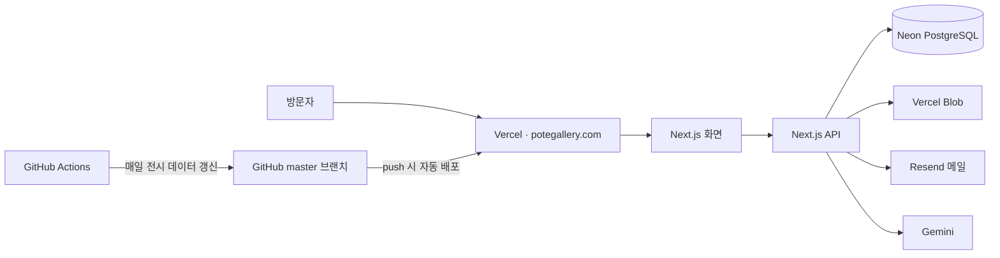

# POTE — 신진 작가 온라인 갤러리

> 신진·독립 작가의 오리지널 작품을 소개하고, 첫 컬렉터의 구매 문의를 작가와 연결하는 온라인 갤러리입니다.
> 기획, 개발, 배포, 운영을 혼자 맡고 있습니다.

**🔗 서비스: [potegallery.com](https://potegallery.com)**

<!-- 스크린샷 2~3장: 홈 / 작품 상세 / 모바일 화면 -->
<!--  -->

---

## 한눈에 보기

| 항목 | 내용 |
| --- | --- |
| 기간 | 2026.09 ~ 운영 중 |
| 역할 | 1인 기획·개발·배포·운영 (작가 섭외와 문의 응대 포함) |
| 개발 방식 | Claude Code·Codex로 개발하고, 보안·DB·배포는 직접 점검하고 검증 |
| 규모 | 운영 저장소(비공개) 커밋 880개 이상, 페이지 40여 개, API 라우트로 문의·로그인·작품 승인 처리 |

## 기술 스택

- **Frontend**: Next.js 16 (App Router), React 19, TypeScript, Tailwind CSS 4
- **Backend**: Next.js Route Handler (별도 서버 없이 Vercel 서버 함수로 실행)
- **Database**: Neon PostgreSQL (`@neondatabase/serverless`)
- **Storage**: Vercel Blob (작품 사진, 신청 첨부 파일)
- **AI**: Gemini API (작품 안내 챗봇, 작품 정보 검토, 한영 번역)
- **Mail**: Resend (문의·작가 신청 알림)
- **Infra**: Vercel (GitHub 연동 자동 배포), GitHub Actions (매일 공공 전시 데이터 갱신)

## 주요 기능

**방문자**
- 분위기·취향별 작품 탐색, 관심 작품 저장, 한/영 전환
- 작품 구매·협업 문의 → 운영자에게 메일로 전달 (사이트 안에서 결제하지 않고, 확인 후 작가와 직접 거래)
- 공간 사진을 기반으로 한 작품 추천 요청
- AI 안내 데스크: 작품·구매 관련 질문에 Gemini가 답변하고, 실패하면 규칙 기반 답변으로 대체

**작가**
- 작가 계정 로그인, 작품 제출, 수정 요청
- 입점 신청서 접수와 접수 확인 메일

**운영자**
- 작품 검토·승인, 판매 상태·노출 관리
- 방문 기록과 유입 경로 확인
- 공공 전시 데이터 자동 수집 (GitHub Actions, 매일 1회)

## 구조



## 직접 고민하고 해결한 것

- **로그인 보안**: 비밀번호를 scrypt 해시로 저장하고, 세션은 HMAC으로 서명한 쿠키로 확인합니다. 관리자·작가 권한을 분리했습니다.
- **비밀값 관리**: API 키와 DB 주소는 코드에 넣지 않고 `.env.local`(로컬), Vercel 환경변수(운영), GitHub Secrets(Actions)로만 관리합니다.
- **AI 장애·비용 대비**: Gemini 답변이 없으면 키워드 기반 답변으로 대체해 안내가 끊기지 않게 했고, 한 방문자가 무료 사용량을 다 쓰지 못하도록 요청 횟수를 제한했습니다.
- **중복 배포 정리**: Actions의 수동 배포와 Git 자동 배포가 같은 커밋을 두 번 배포하던 문제를 찾아, 자동 배포 하나로 정리했습니다.
- **데이터 갱신 즉시 반영**: 작품 승인·수정 후 `revalidatePath`로 해당 페이지 캐시를 갱신합니다.
- **빌드 전 자동 검사**: 빌드 전에 문구 오류와 사진 비율을 스크립트로 검사합니다 (`npm run build` 의 prebuild).

## 이 저장소에 대해

실제 운영 저장소는 작가 연락처·운영 문서가 들어 있어 비공개로 두고, 이 저장소에는 **코드만** 옮겼습니다.

- 작가 작품 사진(`public/artists`), 배경음악, 공간 사진은 작가 저작권 때문에 넣지 않았습니다. 그래서 로컬에서 실행하면 이미지가 비어 보입니다. 실제 화면은 [potegallery.com](https://potegallery.com)에서 확인할 수 있습니다.
- 작가 사업자 정보 같은 개인정보는 빈 값으로 바꿨습니다.
- 운영 문서와 자동화 워크플로는 빼고 올렸습니다.

## 로컬 실행

```bash
npm install
cp .env.example .env.local   # 값은 직접 채워야 합니다
npm run dev
```

필요한 환경변수 이름 (값은 저장소에 없습니다):
`DATABASE_URL`, `RESEND_API_KEY`, `MAIL_FROM`, `ARTIST_SESSION_SECRET`, `ADMIN_PASSWORD`, `GEMINI_API_KEY`, `CRON_SECRET`, `NEXT_PUBLIC_SITE_URL`

## 만든 사람

김지현 — 병원 행정·원무 5년 차에서 개발로 전환했습니다. 현장에서 본 문제를 직접 기획하고, AI 도구로 빠르게 만들어 실제 사용자에게 검증합니다.
